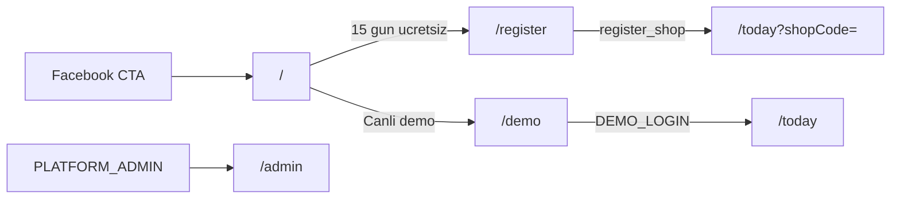

# Self-serve kayıt, demo ve kurucu paneli

## Kararlar (kilitli)

- Model: mevcut `workspaces` / `users` / `memberships` + `PLATFORM_ADMIN_EMAILS` korunur (`SUPER_ADMIN_EMAIL` eklenmez).
- Slug: formda yok; [`registerAction`](src/app/(auth)/actions.ts) içinde `slugifyShopName(shopName) + '-' + 3 hane` üretilir, `slug_taken` olursa yeniden dener (max ~5). RPC hâlâ `_slug` alır.
- Kayıt sonrası: `/welcome` zorunlu değil → `/today?shopCode=<slug>`; tek seferlik kapatılabilir banner.
- E-posta onayı: kod session varsa içeri alır. **Canlıda Supabase Auth → Confirm email kapalı olmalı**; aksi halde session gelmez. Confirm açıksa kullanıcıya net Türkçe hata (confirm-pending’e sessizce düşürme yok).
- Demo: [`/demo`](src/app/(auth)/demo/route.ts) server route → `signInWithPassword(DEMO_LOGIN_EMAIL, DEMO_LOGIN_PASSWORD)` → `/today`.
- Örnek iş: `register_shop` sonunda `intake`, plaka normalize `34ORN001`, şikayet: `Örnek İş Emri — İnceleyip silebilirsiniz`.

---

## 1. Migration `022_self_serve_shop_meta.sql`

Dosya: [`supabase/migrations/022_self_serve_shop_meta.sql`](supabase/migrations/022_self_serve_shop_meta.sql)

- `alter table workspaces add column if not exists city_district text;`
- `register_shop(_name, _slug, _full_name, _owner_phone text default '', _city_district text default '')` replace:
  - `users.phone := normalize_phone(_owner_phone)`
  - `workspaces.city_district`, `settings` içinde `phone` (WhatsApp şablonları için)
  - `trial_ends_at = now() + 15 days` (016 ile aynı)
  - Sonunda örnek araç + müşteri + `work_orders` (`status = intake`, complaint metni yukarıdaki)
- Eski 3-arg overload’ı drop edip yeni imzaya `grant execute … to authenticated`
- Uygulama bitince SQL’in **tam metni** chat’e yapıştırılacak (canlı SQL Editor için)

---

## 2. Kayıt UI + action

| Dosya | Değişiklik |
|--------|------------|
| [`src/lib/validations/auth.ts`](src/lib/validations/auth.ts) | `slug` kaldır; `phone`, `cityDistrict` ekle (oauth şemasına da) |
| [`src/components/auth/register-form.tsx`](src/components/auth/register-form.tsx) | 5 alan; slug kutusu yok; üstte “2 dakikada dükkanın hazır”; Google ikincil (altında “veya Google”) |
| [`src/app/(auth)/actions.ts`](src/app/(auth)/actions.ts) | Slug üret + RPC’ye phone/city; başarı → `/today?shopCode=…`; session yoksa confirm-pending yerine anlamlı hata |
| [`src/lib/validations/auth.test.ts`](src/lib/validations/auth.test.ts) | Yeni şemaya göre güncelle |
| [`src/app/(auth)/register/page.tsx`](src/app/(auth)/register/page.tsx) | Kısa kopya metni |

Banner: küçük client bileşen (ör. `ShopCodeBanner`) — `/today` üstünde `shopCode` query’si varsa gösterir; kapatınca `localStorage` / cookie ile bir daha açılmaz. Link: “Usta ekle” → `/team` veya `/welcome` (zorunlu değil).

---

## 3. `/demo` + ana sayfa

- Yeni route: `src/app/(auth)/demo/route.ts` (veya `page.tsx` + server action) — env yoksa landing’e hata query ile dön.
- [`src/lib/supabase/proxy.ts`](src/lib/supabase/proxy.ts): `PUBLIC_PREFIXES`’e `/demo`
- [`.env.example`](.env.example) + [`docs/LAUNCH_CHECKLIST.md`](docs/LAUNCH_CHECKLIST.md): `DEMO_LOGIN_EMAIL`, `DEMO_LOGIN_PASSWORD`
- [`src/components/landing/home-content.tsx`](src/components/landing/home-content.tsx): ikincil CTA → `/demo`; alt nota muhasebe/maliye cümlesi

---

## 4. `/admin` kurucu paneli

- [`src/lib/data/admin-workspaces.ts`](src/lib/data/admin-workspaces.ts): `city_district`; owner `full_name` + `phone` (memberships join); metrikler service role ile — iş emri sayısı, usta/çırak (`mechanic`/`apprentice`) sayısı, `max(work_orders.updated_at)` (yoksa `created_at`)
- [`src/components/platform/admin-workspace-forms.tsx`](src/components/platform/admin-workspace-forms.tsx): kartta il/ilçe, yetkili, kalan deneme günü, WA butonu (`https://wa.me/90…?text=…` karşılama), metrikler; **+15 Gün Uzat** / **Aktif Yap** (manuel datetime formunu geri plana al veya kaldır)
- [`src/app/(platform)/admin-actions.ts`](src/app/(platform)/admin-actions.ts): `extendTrial15Action`, `activateWorkspaceAction` (`plan=active`, `is_suspended=false`, istenirse trial ileri)

---

## 5. Doğrulama ve teslim

1. `npm run build`
2. Kullanıcı isteğiyle GitHub’a push (`main` veya mevcut branch)
3. Chat’e `022_self_serve_shop_meta.sql` tam içeriği
4. Hatırlatma: Vercel’e `DEMO_*` + mevcut `PLATFORM_ADMIN_EMAILS`; Supabase Confirm email off; migration canlıda çalıştır

`/welcome` dosyası silinmez; sadece kayıt akışı oraya zorlamaz.